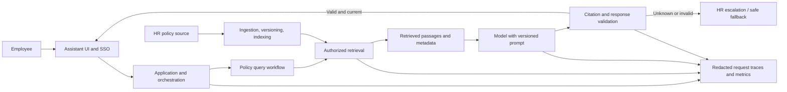

# System and Trust-Boundary Map

> **Exercise case: synthetic.** The product, policy, user, incident, and all example values below are invented for the workshop. This map is a working hypothesis, not a verified production architecture.

## System Context

- **System:** Internal employee reimbursement-policy assistant
- **Primary user:** Employee asking what expenses are eligible and what limits apply
- **Task or decision supported:** Find and understand the policy in effect for a given region and date; not approve or submit a claim
- **Expected outcome:** A concise answer grounded in the current, applicable policy, with a source citation and escalation when applicability is unclear
- **Unacceptable outcome:** Present an expired limit as current, expose a policy the user is not allowed to see, or make an approval decision
- **Accountable owner:** Assumed for exercise: Employee Experience product owner; HR Policy owns source content, Platform owns retrieval and serving

## Request Flow

**Assumptions to verify:** the assistant uses RAG; the interface uses SSO; retrieval enforces document permissions; the output validator can inspect cited document IDs and effective dates; there is a human HR escalation path. None of these implementation details is confirmed by real system evidence.

## Data and Knowledge Flow

| Data or content | Source and owner | Processing or storage | Used when | Freshness requirement |
|---|---|---|---|---|
| Reimbursement policies | HR Policy; authoritative source assumed | Parsed, versioned, indexed; expired versions should be removed or marked | Every policy question | Current effective policy must be available at publication |
| User identity and region | Identity provider / HR directory; owners to confirm | Passed to application; used for authorization and applicable policy selection | Request handling and retrieval | Current at each request |
| Query and conversation context | Employee; product owner to confirm | Sent to orchestration/model; retention and redaction policy unknown | Answer generation | Current request; retain only as permitted |
| Retrieved passages and metadata | Search index; Platform assumed | Ranked and assembled into model context | Answer generation and citation | Must match effective date and user permissions |
| Response, citation, and outcome | Application | Returned to employee; limited telemetry should record versions and outcome | Response and evaluation | Immediate; telemetry policy to confirm |

## Components and Responsibilities

| Component | Responsibility | Input | Output | Owner | Known or assumed? |
|---|---|---|---|---|---|
| Assistant UI | Collect question, show answer/citation, offer escalation | Employee query and identity | Request and displayed answer | Product | Assumed |
| Identity and authorization | Establish user and allowed policy scope | SSO identity and group/region | Authorized context | Security / HR systems | Assumed |
| Orchestration | Route question, assemble context, call model | Query, identity, workflow state | Model request | Platform | Assumed |
| Policy ingestion | Parse, label, version, index, retire policy documents | HR source documents | Searchable policy records | HR Policy / Platform | Assumed |
| Retrieval | Select permitted, relevant, effective passages | Query, user scope, index | Ranked passages and metadata | Platform | Assumed |
| Model | Draft answer from instructions and supplied context | Prompt and retrieved passages | Candidate answer | AI Platform | Assumed |
| Response validator | Check citation, effective date, and fallback conditions | Candidate answer and retrieved metadata | Approved answer or escalation | Platform / Product | Assumed |
| Telemetry | Support diagnosis and evaluation with minimised data | Request stages and outcomes | Trace and aggregate measures | Platform / Privacy | Assumed |
| HR escalation | Resolve questions the assistant cannot safely answer | Employee question and cited policy | Human response | HR Operations | Assumed |

## Trust Boundaries and Permissions

| Boundary | Data or authority crossing it | Required control | Failure impact |
|---|---|---|---|
| Employee to assistant | Question, identity, possible personal details | Authentication, input minimisation, safe handling | Unauthorised access or sensitive data exposure |
| HR source to ingestion/index | Internal policy content and effective dates | Source ownership, integrity checks, version and retirement controls | Stale or incorrect policy becomes retrievable |
| Retrieval to model context | Policy passages and metadata | Permission filtering before context assembly; mark source and effective date | Outdated or unauthorised evidence influences answer |
| Model to user-facing response | Generated claims and citations | Validate citations against retrieved documents; abstain on ambiguity | Confident unsupported policy guidance |
| Application to telemetry | Prompts, IDs, outputs, timings | Redaction, access control, retention and deletion limits | Sensitive employee/policy data persists in logs |
| Assistant to HR escalation | Query and conversation context | Minimise shared context; preserve ownership and auditability | Unnecessary disclosure or lost follow-up |

## Human Oversight and Recovery

- **Review or approval:** HR owns policy interpretation and exceptions. The assistant must escalate when no current applicable source is found or sources conflict.
- **User correction:** Show the cited policy title and effective date; provide a report/escalate action.
- **Fallback:** Do not state a numeric limit if source currency or applicability cannot be validated; direct the employee to the authoritative HR channel.
- **Reversibility:** Disable policy-answering or a specific policy topic, roll back an index/prompt/model version, and restore a prior validated index. These capabilities are assumptions to verify.

## Architecture Unknowns

| Unknown | Why it matters | Best source or owner to clarify it |
|---|---|---|
| Which policy repository is authoritative? | Needed to establish correct content and effective date | HR Policy owner |
| Does the index retain expired versions? How are they marked? | Distinguishes ingestion/versioning problems | Search Platform owner and index manifest |
| Is effective date used in retrieval filters or ranking? | Distinguishes serving selection problems | Retrieval configuration and request trace |
| Is there a response cache? What keys and TTL apply? | A cached old answer could bypass fresh retrieval | Application owner and cache telemetry |
| What identity attributes govern document access and regional applicability? | Prevents cross-user or wrong-region answers | Security and HR systems owners |
| Can traces safely retain query, retrieved IDs, versions, and cache status? | Enables diagnosis without excessive sensitive-data collection | Privacy, Security, Platform |
| What is the actual fallback/escalation path and owner? | Determines safe containment and recovery | Product and HR Operations |
